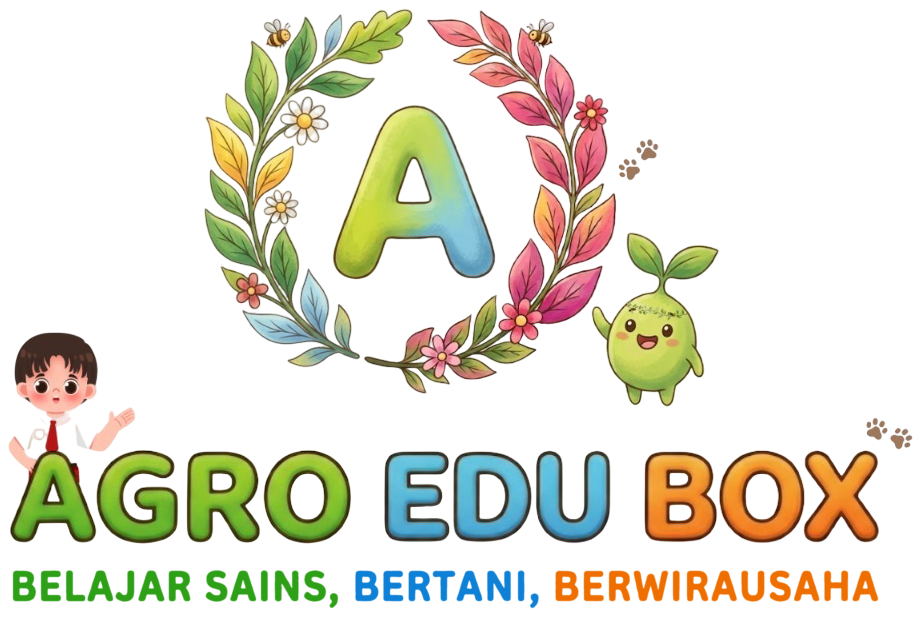

<div align="center">



# 🌱 AgroEdu Box (Smart IoT Agriculture Learning Platform)

**Platform Edukasi Agrikultur Modern Berbasis IoT & Gamifikasi Interaktif untuk Generasi Muda**

[](https://nextjs.org/)
[](https://react.dev/)
[](https://www.typescriptlang.org/)
[](https://tailwindcss.com/)
[](https://supabase.com/)
[](https://agro-edu-box.vercel.app)

[🌐 Kunjungi Website Live](https://agro-edu-box.vercel.app) • [📖 Panduan API IoT](#-integrasi-iot--telemetri) • [🚀 Memulai Proyek](#-instalasi--menjalankan-lokal)

---

</div>

## 📌 Tentang Sistem

**AgroEdu Box** adalah platform web edukasi pertanian pintar (*smart agriculture*) yang menghubungkan pembelajaran teori agrikultur dengan telemetri sensor Internet of Things (IoT) secara *real-time*. 

Sistem ini dirancang khusus untuk siswa sekolah dan guru agar proses praktikum pertanian hidroponik/media tanam tidak lagi dilakukan secara abstrak, melainkan berbasis bukti data ilmiah (*data-driven farming*) yang menyenangkan, mudah dipahami, serta ramah perangkat bergerak (*mobile-first*).

---

## 🎯 Tujuan Dibuat

1. **Edukasi Pertanian Modern Berbasis Data**: Mengenalkan konsep pertanian presisi (*precision agriculture*) kepada siswa sejak dini melalui pembacaan sensor fisik.
2. **Konektivitas Teori dan Praktik Nyata**: Membantu siswa menghubungkan kondisi visual tanaman (seperti daun layu/segar) dengan parameter lingkungan kuantitatif (suhu udara dan kelembapan tanah).
3. **Pembelajaran Aktif & Terstruktur**: Menyediakan alur belajar bertahap: *Eksplorasi Materi → Pengamatan Lab IoT → Pelaksanaan Kartu Misi Lapangan → Evaluasi Kuis → Sertifikat Kelulusan*.
4. **Alat Bantu Pemantauan Guru (AGRO EDU TRACK)**: Memfasilitasi guru pembimbing dalam mengelola kelas, memantau kesehatan alat IoT, serta menilai tugas siswa dengan rubrik kompetensi terstandar.

---

## ⚡ Fitur Utama

### 🧑‍🌾 1. Area Siswa (Petani Muda)
- **Onboarding Ceria & Pemilihan Karakter**: Masuk dengan nama dan kode kelas, serta memilih avatar maskot tunas ceria (*Original* atau *Girl*).
- **Dashboard Beranda Cerdas**: Ringkasan telemetri live perangkat box (suhu udara & kelembapan tanah), progres misi harian, kuis aktif, dan total perolehan bintang.
- **Modul Pembelajaran & Bioskop Agro**: Modul interaktif lengkap dengan simulasi pergerakan air dan respon sensor resistif A0.
- **Lab IoT Telemetri Real-Time**: Pemantauan 2 parameter sensor utama (suhu udara DHT22 dan kelembapan tanah A0) yang ter-update otomatis via polling data live.
- **Kartu Misi & Tugas Digital**: Formulir pengerjaan tugas ilmiah dengan integrasi bukti telemetri sensor, unggah foto/dokumen, dan refleksi belajar.
- **Kuis Pintar & Sertifikat Digital**: Latihan soal interaktif dengan pembahasan lengkap, mode presentasi kelas layar penuh, serta fitur cetak sertifikat kelulusan digital.
- **Profil & Gamifikasi**: Peringkat bintang, koleksi piala, riwayat aktivitas, dan saluran umpan balik langsung dari guru pembimbing.

### 👨‍🏫 2. Area Guru (AGRO EDU TRACK)
- **Portal Otentikasi Khusus**: Login terpisah untuk guru pembimbing.
- **Dashboard Analitik**: Ringkasan jumlah kelas aktif, status perangkat IoT (online/offline), dan persentase penuntasan materi.
- **Manajemen Kelas & Siswa**: Pembuatan kelas baru, distribusi kode kelas, dan penelusuran detail progres per siswa.
- **Monitoring Data IoT Seluruh Box**: Pemantauan integritas data telemetri ESP32/Arduino, deteksi data hilang, dan konfigurasi ambang batas parameter.
- **Penilaian & Rubrik Tugas**: Evaluasi kiriman tugas siswa, verifikasi bukti sensor, pemberian nilai, serta catatan revisi.

---

## 🛠️ Tech Stack

### Frontend & Aplikasi Web
| Teknologi | Keterangan |
|---|---|
| **Next.js 15 (App Router)** | Framework React utama dengan dukungan Server & Client Components |
| **React 19** | Library UI modern dan reaktif |
| **TypeScript** | Type-safe code untuk keandalan data sensor dan struktur modul |
| **Tailwind CSS** | Utility-first CSS dengan custom design tokens (Soft 3D pill rounded) |
| **Recharts** | Visualisasi grafik tren historis telemetri sensor IoT |
| **Lucide React** | Ikonografi modern yang bersih dan intuitif |
| **SweetAlert2** | Dialog konfirmasi dan notifikasi interaktif bertema khusus |

### Backend, Database & Storage
| Komponen | Keterangan |
|---|---|
| **Next.js Route Handlers** | RESTful API Endpoints (`/api/iot/ingest`, `/api/iot/data`, `/api/siswa/*`, `/api/kelas/*`) |
| **Supabase (PostgreSQL)** | Penyimpanan data relasional persisten (Kelas, Siswa, Progres, Telemetri) |
| **IoT Telemetry Store** | Global in-memory cache + fallback untuk responsivitas telemetri real-time |

### Hardware & Perangkat IoT
- **Mikrokontroler**: ESP32 / Arduino Uno R4 WiFi / ESP8266
- **Sensor Lingkungan**:
  - Sensor Suhu Udara (DHT22 / DHT11)
  - Sensor Kelembapan Tanah (Capacitive Soil Moisture v1.2 / Resistive Analog A0)
  - Output Alarm Aktuator (Buzzer & LCD 16x2 I2C)
- **Protokol Komunikasi**: HTTP REST POST (JSON) & MQTT Broker Bridge Ready

---

## 📡 Integrasi IoT & Telemetri

Alat mikrokontroler (Arduino/ESP32) mengirimkan data ke sistem melalui HTTP POST:

- **Endpoint**: `https://agro-edu-box.vercel.app/api/iot/ingest`
- **Method**: `POST`
- **Content-Type**: `application/json`

### Contoh Payload JSON:
```json
{
  "deviceId": "pot-a",
  "firmwareVersion": "1.0.0",
  "readings": [
    {
      "sensorType": "soil_moisture",
      "value": 48.5,
      "unit": "%"
    },
    {
      "sensorType": "air_temp",
      "value": 27.8,
      "unit": "°C"
    }
  ]
}
```

Dashboard siswa dan guru akan menyinkronkan data baru secara live tanpa perlu memuat ulang halaman.

---

## 💻 Instalasi & Menjalankan Lokal

### Prasyarat
- [Node.js](https://nodejs.org/) (versi 18.18 atau lebih baru)
- Git
- NPM atau PNPM

### Langkah Instalasi

1. **Clone repositori**:
   ```bash
   git clone https://github.com/EkoMuhammadRizki/AgroEdu-Box.git
   cd AgroEdu-Box
   ```

2. **Install dependensi**:
   ```bash
   npm install
   ```

3. **Konfigurasi Environment Variables**:
   Salin `.env.example` menjadi `.env.local`:
   ```bash
   cp .env.example .env.local
   ```
   Isi konfigurasi Supabase (opsional jika menggunakan mode demo lokal):
   ```env
   NEXT_PUBLIC_SUPABASE_URL=your_supabase_project_url
   NEXT_PUBLIC_SUPABASE_ANON_KEY=your_supabase_anon_key
   SUPABASE_SERVICE_ROLE_KEY=your_supabase_service_role_key
   ```

4. **Jalankan server pengembangan**:
   ```bash
   npm run dev
   ```

5. Buka peramban di [http://localhost:3000](http://localhost:3000).

---

## 📱 Desain Responsif (Mobile-First)

Website telah dioptimalkan secara mendalam untuk perangkat laptop maupun ponsel pintar (teruji presisi pada viewport iPhone 13 / 390px), lengkap dengan dukungan *iOS Safe Area* untuk notch dan *home indicator*.

---

## 👥 Pengembang & Lisensi

Dikembangkan untuk proyek inovasi pendidikan pertanian pintar **AgroEdu Box Indonesia**.

© 2026 AgroEdu Box. Seluruh hak cipta dilindungi.
